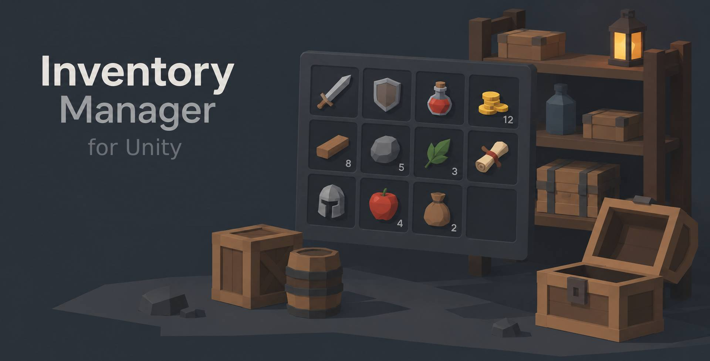
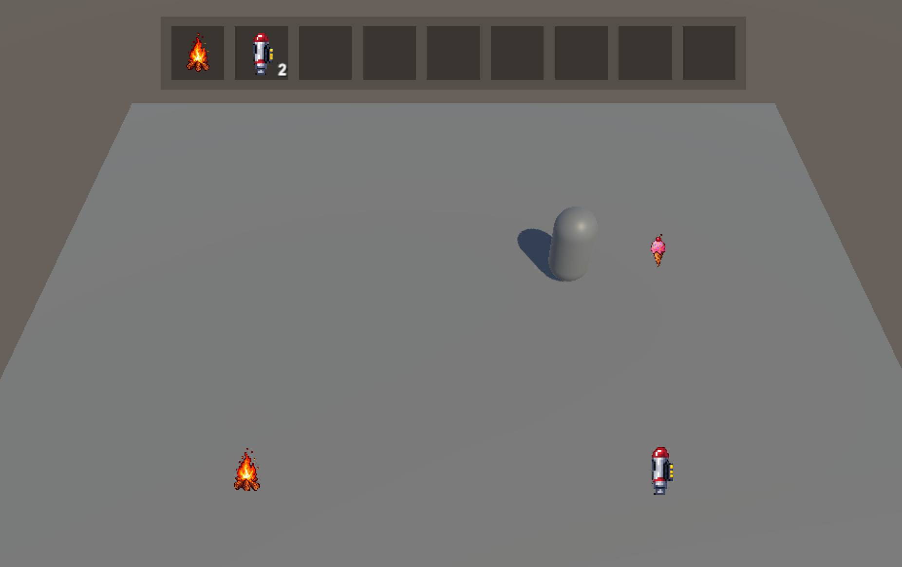

# Unity Inventory Manager

An inventory system for Unity 6 that works in **2D and 3D**: grid, hotbar, pickups, drop, use, drag and drop, and tooltips. No code needed.



## Open from Unity Hub (try the demos)

1. Click **Code → Download ZIP** and extract it.
2. In Unity Hub, click **Add → Add project from disk** and choose the extracted folder.
3. Open the project with Unity 6, then open a scene from `Assets/InventoryDemo`.

If the scenes are missing, run **Tools → Inventory → Create Demo Scenes**.

## Add to an existing project

Copy the folder `Packages/unity.guibot.inventorymanager` into your project's `Packages` folder (next to `Assets`). Unity imports it automatically.

Or use the Package Manager: **+ → Add package from git URL**:

```
https://github.com/guibot/Unity-InventoryManager.git?path=/Packages/unity.guibot.inventorymanager
```

Requires Unity 6 and the Unity UI package. For 3D lighting and shadows, use URP with the **Universal Renderer**.

## Quick start

1. **Item:** *Create → Inventory → Item* in the Project window. Add a name and a sprite (set the PNG to *Texture Type: Sprite*).
2. **Player:** select your player, then **GameObject → Inventory → Make Selected the Player**.
3. **Pickup:** right-click the item → **Inventory → Create Pickup 2D in Scene** (or 3D). Press Play.

## Controls

| Key | Action |
|-----|--------|
| **I** | Open / close the grid |
| **1–9** or click a slot | Select a slot |
| **E** | Use the selected item |
| **G** | Drop the selected item |
| Drag a slot | Move, merge or swap items |
| Right-click a slot | Use the item |

## Troubleshooting

- **3D objects pink or flat, no shadows:** the project is not using URP, or the URP Asset uses the 2D Renderer. Use a Universal Renderer.
- **Sprite missing from the Icon list:** set the PNG to *Texture Type: Sprite (2D and UI)* and click Apply.
- **Pickup is not collected:** the player needs a `Rigidbody` (or `Rigidbody2D`), and the pickup collider needs *Is Trigger*.

## License

MIT. See [LICENSE](LICENSE).

---

Orchestrated by Guilherme Martins (aka guibot - https://guilhermemartins.net) and vibecoded with Claude.
